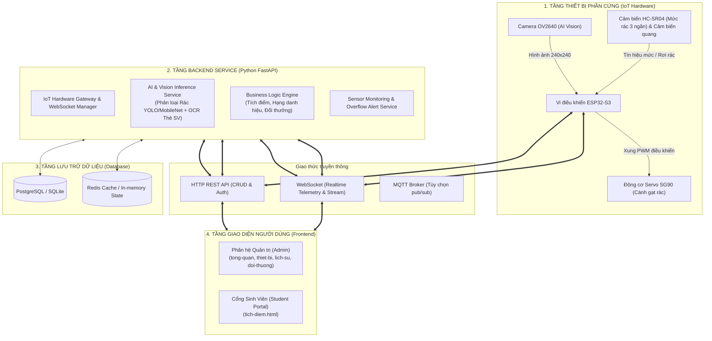
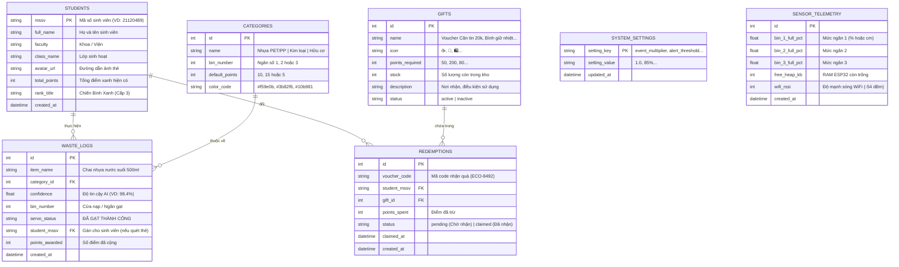

# KIẾN TRÚC HỆ THỐNG BACKEND – DỰ ÁN THÙNG RÁC THÔNG MINH IOT

> **Dự án:** Thùng Rác Thông Minh Phân Loại Rác Tự Động Bằng AI Vision & Vi Điều Khiển ESP32-S3  
> **Tài liệu:** Thiết kế kiến trúc tổng thể Backend, Cơ sở dữ liệu và Giao thức truyền thông  
> **Phiên bản:** 1.0  
> **Ngày lập:** 06/11/2026  

---

## I. TỔNG QUAN KIẾN TRÚC TOÀN HỆ THỐNG (High-Level Architecture)

Hệ thống được tổ chức thành **4 tầng kiến trúc** độc lập nhưng liên kết chặt chẽ qua các giao thức thời gian thực (Realtime WebSockets) và HTTP RESTful APIs.



---

## II. LỰA CHỌN CÔNG NGHỆ ĐỀ XUẤT (Technology Stack)

| Thành phần | Công nghệ đề xuất | Lý do & Ưu điểm |
| :--- | :--- | :--- |
| **Ngôn ngữ & Framework** | **Python (FastAPI)** | Tốc độ xử lý bất đồng bộ (asyncio) vượt trội; tích hợp trực tiếp các thư viện AI/ML (PyTorch, OpenCV, ONNX Runtime); tự động sinh tài liệu Swagger/OpenAPI. |
| **Giao thức thời gian thực** | **WebSockets (`ws://`)** | Truyền nhận dữ liệu cảm biến đo khoảng cách, log kết nối ESP32 và FPS camera trực tiếp lên Dashboard không độ trễ. |
| **Mô hình AI Phân loại rác** | **YOLOv8-nano / MobileNetV2** | Kích thước siêu nhẹ (< 15MB), thời gian suy luận (inference) < 50ms, phân loại chính xác: *Nhựa, Kim loại, Hữu cơ*. |
| **Mô hình AI OCR Thẻ SV** | **PaddleOCR / EasyOCR** | Đọc chữ tiếng Việt chính xác cao trên thẻ sinh viên (MSSV, Họ tên, Khoa, Lớp) từ ảnh chụp camera điện thoại/kiosk. |
| **Cơ sở dữ liệu (Database)** | **SQLite (Prototype)**<br>hoặc **PostgreSQL (Production)** | Lưu trữ cấu trúc quan hệ: Sinh viên, Lịch sử phân loại, Điểm tích lũy, Kho quà tặng, Cấu hình tỷ lệ điểm. |
| **Cache & Realtime State** | **Redis (Tùy chọn)** | Lưu trạng thái sống/chết (Heartbeat) của ESP32, cache lượt nạp rác đang chờ tích điểm. |

---

## III. CẤU TRÚC THƯ MỤC BACKEND CHUẨN (Directory Tree)

```text
backend/
├── app/
│   ├── main.py                  # Điểm khởi chạy FastAPI application & cấu hình CORS/WebSocket
│   ├── config.py                # Biến môi trường (DB_URL, ESP32_SECRET, MODEL_PATHS)
│   │
│   ├── api/                     # Định tuyến các cổng API (Routes)
│   │   ├── v1/
│   │   │   ├── iot.py           # API nhận telemetry từ ESP32, điều khiển cánh gạt servo
│   │   │   ├── ai_vision.py     # API nhận diện ảnh rác & OCR quét thẻ sinh viên
│   │   │   ├── students.py      # Tra cứu hồ sơ sinh viên, bảng xếp hạng điểm xanh
│   │   │   ├── rewards.py       # Thiết lập điểm quy đổi, quản lý kho quà, sinh voucher
│   │   │   └── dashboard.py     # Dữ liệu thống kê tổng hợp cho Admin Dashboard
│   │   └── websocket.py         # Kênh kết nối WebSocket giữa ESP32 và Frontend
│   │
│   ├── models/                  # Định nghĩa bảng Database (SQLAlchemy ORM)
│   │   ├── student.py           # Bảng students (MSSV, tên, điểm tích lũy, rank)
│   │   ├── waste_log.py         # Bảng waste_logs (nhật ký phân loại rác)
│   │   ├── reward.py            # Bảng gifts, redemptions (quà & voucher)
│   │   ├── system_setting.py    # Bảng cấu hình tỷ lệ điểm (plastic, metal, organic, mult)
│   │   └── sensor_log.py        # Bảng lịch sử mức dung tích 3 ngăn
│   │
│   ├── schemas/                 # Pydantic schemas (Validate dữ liệu đầu vào/ra của API)
│   │   ├── student_schema.py
│   │   ├── reward_schema.py
│   │   └── iot_schema.py
│   │
│   ├── services/                # Nghiệp vụ xử lý cốt lõi (Business Logic)
│   │   ├── ai_service.py        # Tải mô hình YOLOv8 & chạy suy luận nhận diện rác
│   │   ├── ocr_service.py       # Trích xuất MSSV, họ tên từ ảnh thẻ sinh viên
│   │   ├── point_service.py     # Tính điểm theo tỷ lệ + hệ số sự kiện, cộng điểm cho SV
│   │   └── esp32_service.py     # Xử lý bắt tay kết nối, đóng gói lệnh điều khiển servo
│   │
│   └── database/                # Khởi tạo kết nối CSDL & Session
│       ├── connection.py
│       └── init_db.py           # Tạo bảng tự động và seed dữ liệu mẫu ban đầu
│
├── ai_models/                   # Thư mục chứa các trọng số AI đã huấn luyện
│   ├── waste_yolov8n.onnx       # Mô hình phân loại rác (Nhựa / Kim loại / Hữu cơ)
│   └── student_ocr/             # Weights OCR đọc thẻ sinh viên
│
├── requirements.txt             # Danh sách thư viện Python
└── Dockerfile                   # Đóng gói triển khai container
```

---

## IV. THIẾT KẾ CƠ SỞ DỮ LIỆU (Database Schema / ERD)



---

## V. HỆ THỐNG API ENDPOINTS CỐT LÕI

### 1. Nhóm API IoT & Vi điều khiển ESP32
* `POST /api/v1/esp32/heartbeat`: ESP32 gửi gói tin báo sống định kỳ (RAM heap, RSSI, Ping).
* `POST /api/v1/esp32/sensors/distance`: Cập nhật mức rác từ cảm biến siêu âm HC-SR04 vào 3 ngăn.
* `POST /api/v1/esp32/trigger-photo`: Cảm biến quang kích hoạt khi rác rơi $\rightarrow$ ESP32 báo Backend sẵn sàng phân loại.
* `POST /api/v1/esp32/classify-frame`: ESP32-CAM upload ảnh vừa chụp $\rightarrow$ Backend chạy AI Vision phân loại $\rightarrow$ trả về góc quay servo (`servo_angle: 90` hoặc `180` hoặc `0`).
* `WebSocket /ws/iot-telemetry`: Stream dữ liệu realtime 2 chiều giữa ESP32 $\leftrightarrow$ Backend $\leftrightarrow$ Web Dashboard.

### 2. Nhóm API Quản trị & Cấu hình Điểm Thưởng (`doi-thuong.html`)
* `GET /api/v1/settings/rates`: Lấy cấu hình điểm thưởng hiện tại (Nhựa, Kim loại, Hữu cơ, Hệ số nhân).
* `PUT /api/v1/settings/rates`: Cập nhật tỷ lệ điểm và hệ số sự kiện (`1.0x`, `1.5x`, `2.0x`).
* `GET /api/v1/gifts`: Lấy danh sách phần quà trong kho.
* `POST /api/v1/gifts`: Thêm phần quà mới vào danh mục.
* `PUT /api/v1/gifts/{id}`: Sửa điểm, số lượng tồn kho, hoặc bật/tắt mở đổi.
* `DELETE /api/v1/gifts/{id}`: Xóa phần quà.
* `GET /api/v1/redemptions/all`: Xem toàn bộ lịch sử sinh viên đổi quà trên hệ thống.

### 3. Nhóm API Cổng Sinh Viên (`tich-diem.html`)
* `POST /api/v1/students/ocr-scan`: Upload ảnh thẻ sinh viên $\rightarrow$ AI OCR đọc MSSV, họ tên, khoa, lớp $\rightarrow$ trả về thông tin hồ sơ và điểm tích lũy.
* `POST /api/v1/students/claim-reward`: Xác nhận cộng điểm lượt vừa bỏ rác (ví dụ: `+10đ`) vào MSSV.
* `GET /api/v1/students/{mssv}/history`: Xem lịch sử phân loại rác cá nhân của sinh viên đó.
* `POST /api/v1/rewards/redeem`: Sinh viên bấm đổi quà $\rightarrow$ Backend kiểm tra điểm, trừ tồn kho quà, trừ điểm sinh viên và trả về mã `voucher_code` (VD: `ECO-8924`).

---

## VI. LUỒNG HOẠT ĐỘNG THỰC TẾ (Core Workflows)

### Luồng 1: Tự động phân loại rác cơ khí bằng AI Vision
```text
[Người dùng bỏ rác vào họng nạp]
       │
       ▼
[Cảm biến quang điện #1 phát hiện] ──► Gửi tín hiệu ngắt đến ESP32-S3
       │
       ▼
[Camera OV2640 chụp ảnh] ──► Upload ảnh qua POST /api/v1/esp32/classify-frame
       │
       ▼
[Backend chạy YOLOv8n] ──► Nhận diện: "Chai nhựa PET" (Độ tin cậy: 98.4%)
       │                    ──► Xác định ngăn đích: Ngăn #1 (Nhựa)
       ▼
[Backend gửi phản hồi ESP32] ──► Lệnh quay Servo SG90 góc 90° để mở ngăn #1
       │
       ▼
[Cảm biến siêu âm HC-SR04] ──► Đo lại khoảng cách, cập nhật dung tích ngăn #1
       │
       ▼
[WebSocket Broadcast] ──► Đẩy thông báo ngay lập tức lên Web Dashboard Admin & Cổng Sinh Viên
```

### Luồng 2: Sinh viên quét thẻ & Tích điểm đổi quà
```text
[Sinh viên mở tich-diem.html hoặc quét QR tại thùng rác]
       │
       ▼
[Chụp/Thả ảnh Thẻ Sinh Viên] ──► Gửi đến POST /api/v1/students/ocr-scan
       │
       ▼
[Backend chạy AI OCR] ──► Trích xuất: MSSV 21120489 - Nguyễn Văn An
       │
       ▼
[Giao diện hiện điểm & thông báo rác vừa nạp] ──► Bấm "Xác nhận tích điểm"
       │
       ▼
[Backend cộng điểm theo quy tắc] ──► 135đ + 10đ = 145đ ──► Cập nhật CSDL
       │
       ▼
[Đủ điểm đổi Voucher] ──► Bấm "Đổi quà" ──► Sinh mã ECO-8492 ──► Đến Căn tin nhận quà!
```

---

## VII. TÍCH HỢP VỚI FRONTEND HIỆN TẠI

Trong giai đoạn Frontend đang chạy với dữ liệu mô phỏng (`localStorage` và mock timers), việc kết nối Backend sẽ diễn ra tuần tự:

1. **Cấu hình API Base URL trong `front_end/assets/js/common.js`**:
   ```javascript
   window.API_BASE_URL = 'http://localhost:8000/api/v1';
   window.WS_BASE_URL = 'ws://localhost:8000/ws';
   ```
2. **Thay thế `localStorage` bằng các hàm `fetch()` bất đồng bộ**:
   - `doi-thuong.js`: Gọi API `/api/v1/settings/rates` và `/api/v1/gifts`.
   - `tich-diem.js`: Gửi ảnh chụp thẻ lên `/api/v1/students/ocr-scan` và gọi `/api/v1/rewards/redeem`.
   - `esp32-connect.js`: Kết nối trực tiếp tới `ws://localhost:8000/ws/iot-telemetry` để nhận log và chỉ số phần cứng thực tế.

